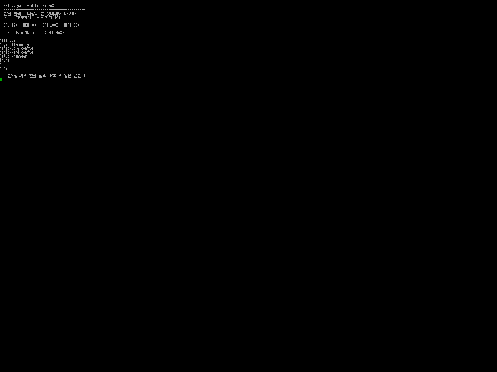
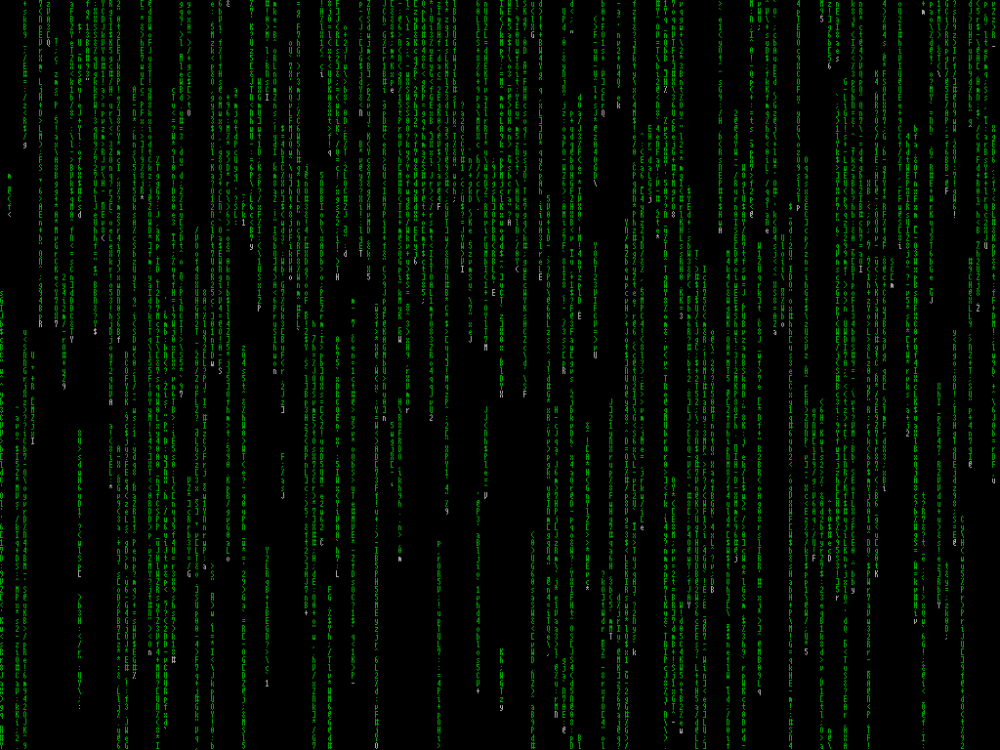

# yaft-dalmoori-8x8

[yaft](https://github.com/uobikiemukot/yaft) ?„ë ˆ?„버???°ë???+ ?œê? ?…ë ¥ ?¨ì¹˜ + **?¬ë¬´ë¦?dalmoori) 8x8 ?„트?°íŠ¸** 빌드.

X/Wayland ?†ì�´ TTY ?„ë ˆ?„버?¼ì—�???œê????°ê¸° ?„í•œ 구성?…니??
ThinkPad X61 (1024x768) 기ì??¼ë¡œ **256ì¹?× 96ì¤?* ?°ë??�ì�´ ?©ë‹ˆ??



cmatrix µµ 256Ä­À¸·Î: 



## 구성

| ??ª© | ?´ìš© |
|---|---|
| 베�??| yaft (MIT, haru) |
| ?œê? ?…ë ¥ | libhangul 기반 ?¨ì¹˜ (ESC ë¡??�문 ?„환, ??????= `0x80` ?¼í‹°?? |
| ?°íŠ¸ | [?¬ë¬´ë¦?(https://github.com/RanolP/dalmoori-font) (Apache-2.0) TTF ??BDF ë³€??|
| ?€ ?¬ê¸° | 4×8 px (ASCII 4px ??/ ?œê? 8px ??= 2?€) |
| ?´ìƒ�??| 1024×768 ??256 cols × 96 lines |

?�본 ?œê? ?¨ì¹˜??[??ê°€?´ë“œ](http://ith.kr/)?�ì„œ ë°°í�¬??것ì�„ 기반?¼ë¡œ ?ˆê³ ,
16×16 ?œê??„깨ë¹??°íŠ¸ ?€??8×8 ?¬ë¬´ë¦??°íŠ¸ë¥??°ë�„ë¡??˜ì •?ˆìŠµ?ˆë‹¤.

## 빌드

?˜ì¡´??

```bash
sudo pacman -S --needed base-devel libhangul
# ?°íŠ¸ë¥??¤ì‹œ 만들 경우?�만
yay -S otf2bdf
```

빌드:

```bash
# mkfont_bdf ??wcwidth() ë¡?글리프 ??�„ ?�ì •?˜ë?ë¡?UTF-8 ë¡œì??¼ì�´ ?„수
export LANG=ko_KR.UTF-8
make clean
make
sudo make install
```

`glyph.h` ??`fonts/dalmoori/dalmoori8.bdf` ë¡œë????�ë�™ ?�성?©ë‹ˆ??

## ?°íŠ¸ ?¤ì‹œ 만들ê¸?
```bash
otf2bdf -p 8 -r 72 -o fonts/dalmoori/dalmoori8.bdf /usr/share/fonts/dalmoori/dalmoori.ttf
make clean && make
```

`otf2bdf` ??8px ?½ì? ?¬ê¸°ë¡?비트맵ì�„ 뽑습?ˆë‹¤.
?¬ë¬´ë¦¬ëŠ” ASCII 4px / ?œê? 8px ??œ¼ë¡??¤ê³„?˜ì–´ ?ˆì–´, ê·¸ë?ë¡??€ ??4px ?°ë??�ì�´ ?©ë‹ˆ??

## ???????¤ì • (콘솔 ?¤ë§µ)

yaft ???????¤ë? `0x80` ë°”ì�´?¸ë¡œ ?¸ì‹�?©ë‹ˆ??

```bash
sudo mkdir -p /etc/kbd
sudo dumpkeys > /etc/kbd/yaft.kmap
cat <<'EOF' | sudo tee -a /etc/kbd/yaft.kmap
string F60 = "\200"
keycode 100 = F60
keycode 130 = F60
EOF

sudo mkdir -p /usr/share/kbd/keymaps/custom
sudo sh -c 'gzip -c /etc/kbd/yaft.kmap > /usr/share/kbd/keymaps/custom/yaft.map.gz'
sudo loadkeys custom/yaft

# 부?????�� ?�용
sudo sed -i 's/^KEYMAP=.*/KEYMAP=custom\/yaft/' /etc/vconsole.conf
```

?¤ì½”?œëŠ” 기종마다 ?¤ë? ???ˆìŠµ?ˆë‹¤. TTY ?�ì„œ `showkey` ë¡??•ì�¸??`keycode N = F60` ??ë§�춰 주세??

## ?¤í–‰

TTY 로그????

```bash
yaft          # 기본 ??(zsh) ?¤í–‰
yaft <명령>    # ?¹ì • 명령 ?¤í–‰
```

- ?????? ?œê? 모드 ? ê?
- ESC: ?�문 모드ë¡??„환 (vim ?±ì—�???¸ì�˜)
- `YAFT_FB_W`, `YAFT_FB_H` ?˜ê²½ë³€?˜ë¡œ ?´ìƒ�??ê°•ì œ ê°€??
## ?Œë ¤ì§??¬í•­

- 빌드?€ ?¤í–‰ 모ë‘� UTF-8 ë¡œì??¼ì�´?´ì•¼ ?©ë‹ˆ??(`LANG=ko_KR.UTF-8`).
- 4px ??ASCII ???‘게 ë³´ì�…?ˆë‹¤. 8px ??�´ ?„ìš”?˜ë©´ 8px BDF ë¥?만들??  makefile ??`mkfont_bdf` ?¸ì��ë§?바꾸ë©??©ë‹ˆ??
- 콘솔 ?¤ë§µ??바꾸므ë¡? yaft ë°–ì�˜ TTY ?�ì„œ ?????¤ëŠ” `0x80` ??출력?©ë‹ˆ??

## ?¼ì�´? ìŠ¤

- yaft: MIT (LICENSE)
- ?¬ë¬´ë¦??°íŠ¸: Apache-2.0 (`fonts/dalmoori/LICENSE`)
- ?œê? ?…ë ¥ ?¨ì¹˜: ??ë°°í�¬??ê°€?´ë“œ 기ì?
